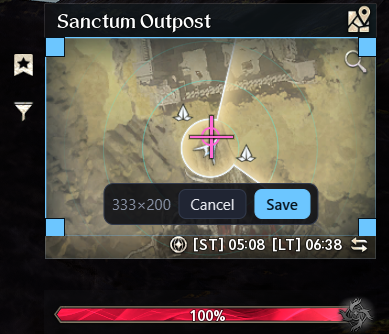

## Install

1. Download `A2Map_x.y.z_x64-setup.exe` from [Releases](../../releases) and run it. No admin needed.
2. Install [Npcap](https://npcap.com) (default options). Without it the map still works, but nothing live shows up.
3. Start the game, then press **Start** in A2Map.

Updates: when a new version is out, an **Update** button appears in the top bar. One click installs it and restarts the app. Your settings are kept.

## Top bar

| | |
|---|---|
| **Start** | Starts live capture. It finds the game's connection and the map you're on by itself. The dot turns green once the game is found. |
| **Map name** | The map shown. *auto* = detected from what's around you, *pinned* = fixed (see Settings). |
| **Nodes / NPCs / Explore** | The three modes, below. |
| **Filter** | Type to search, click or Enter to pick. Pick as many types as you like. Each mode remembers its own filter. ✕ clears it. |

## Modes

### Nodes
Gather nodes and objects (cubes, chests…) spawned around you right now. They appear as they spawn or come into range and vanish when they're gathered, despawn or leave range.

### NPCs
Enemies and NPCs around you right now, drawn as squares. With a crowd around you, names only show when you filter.

### Explore
Browse the whole map: every spot each type can spawn on, taken from the game's files. No capture needed. Turn layers on in **Filters → Explore layers**, or filter for something to see only that.

## Filtering

Pick a type in the filter (say *Hidden Cube*):

- **Every spot it can spawn on** is shown as a grey dot.
- **When one actually spawns** (live capture), its spot lights up with a glow and a white ring.
- **Filtered now** (in the Around panel) lists the spawned ones, nearest first, with distance and direction.

Types with the same name are one entry. Some maps use several ids for the same thing; picking the name picks them all.

## Distance and height

While you filter, the panel at the bottom right shows the **nearest spawned one**:

- **Height**: in big text: ▲ above you, ▼ below, or *same height* (within 3 m). The gauge on the left shows it at a glance.
- **Distance**: how far away it is, which direction, and the straight-line distance.
- **On the map**: a dashed line runs from you to it.

## Map controls

| | |
|---|---|
| **+ / −** or mouse wheel | Zoom. |
| **⤢** | Re-centre and refit. |
| **⌖ Lock on me** | Keeps the map centred on you even when you zoom. Off: zooming stops following until you press ⤢. |
| Drag | Pan (pauses following; ⤢ resumes). |
| Click a node | Shows its details in the Around panel. |

## Around panel

- **Filtered now**: spawned nodes of your filter, nearest first. Click one to centre on it.
- **Spawned now**: everything of the current mode in range, grouped by type. Click a type to add it to the filter. *hide* hides that type.

## Filters panel

| | |
|---|---|
| **Showing** | Your current filter, with how many are up now and how many spots it has on this map. |
| **Show where filtered types can spawn** | The grey possible-spot dots. |
| **Colour spawn groups** | One colour per spawn group; click a spot to highlight its group. |
| **Hidden unless filtered** | Kisks (teleport bindings), feathers and friendly NPCs are hidden to cut clutter. Untick to show them. Filtering for one always shows it. |
| **Hidden list** | Types you hid yourself (and hidden ones around you). *show* brings one back. |
| **Auto-run paths** | The routes your character follows when you auto-run to a quest. Not every map has them yet. |
| **Path visibility** | Low = faint. High = the map dims and the paths glow. |
| **Explore layers** | Place names, gather spots, enemies, objects and NPCs for Explore mode. |

## Overlay

**Overlay → Pop out map** opens an always-on-top, borderless map you can lay over the game (run the game borderless or windowed). It follows the main window's mode, filter, layers and highlights.

| | |
|---|---|
| **Map opacity** | How see-through the map is. |
| **Map tiles** | Off = only nodes, paths and you over the game. |
| **Click-through** | Mouse clicks go to the game, not the overlay. |

Drag the overlay's top bar to move it and its corner to resize. It reopens where you left it.

## Settings

### Map
| | |
|---|---|
| **Map** | Pick the map to show. |
| **Detect map automatically** | Switches to the map you're on. Off = stays on the picked map. |
| **Follow me** | Keeps the map centred on you. |
| **Smooth movement** | Glides your marker between position updates. |

### Minimap tracking
Reads your position from the in-game minimap a few times a second, so the map follows you smoothly while you walk, ride or fly. It only captures the minimap corner of your screen.

1. Press **Set up minimap…**. A box appears.
2. Line the box up with your minimap: top edge just under the area name, bottom edge on the clock line, sides on the minimap's edges.
3. Press Save. Your arrow is found automatically.
4. Tick **Track my position from the minimap**.

**Re-measure scale**: use after changing the minimap zoom, resolution or UI scale.

### Live capture
| | |
|---|---|
| **Adapter** | Leave on *Auto*. It listens on every adapter and locks onto the game's. |
| **Save raw capture** | Saves the traffic to `data\captures\` for bug reports. |
| **Adapter diagnostics** | What each adapter receives. Send a screenshot if the game isn't found. |

### Updates
Check for and install updates.

## Notes

- A2Map only reads: it listens to your network traffic and the minimap corner of your screen. It never touches the game, and sends nothing anywhere.
- Spawn spots, names and paths come from the game's own files and ship with the app. They update with the app.
- Npcap must be installed for anything live.
